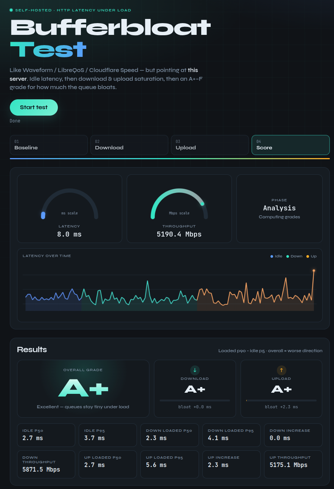

# Bufferbloat Test

Self-hosted **LibreQoS-style** bufferbloat test: one **Go** binary for **VPS** and **OpenWrt**.

The browser (or CLI) talks to **this server** over HTTP: idle latency, then latency under download/upload load, with percentiles and grades **A+–F**.

## Screenshot



## What the result means

| Where the server runs | What you mostly measure |
|-----------------------|-------------------------|
| VPS on the internet | Path through your ISP (classic bufferbloat) |
| OpenWrt on LAN | LAN / Wi‑Fi ↔ router (not necessarily ISP) |
| OpenWrt exposed on WAN | Path to the router from outside (open port; **no auth** in v1) |

## How to run

**Requires:** Go 1.22+ (for local build), or Docker.

### 1. Local (dev / laptop)

```bash
cd custom-bufferbloat

# option A — run without installing a binary
go run ./cmd/server -listen :8080

# option B — build then run
go build -o bufferbloat-test ./cmd/server
./bufferbloat-test -listen :8080
```

Then open in a browser:

- same machine: [http://127.0.0.1:8080](http://127.0.0.1:8080)
- another device on LAN: `http://<host-lan-ip>:8080`

Click **Start test**. The run takes ~45–65 seconds:

baseline → **download and upload calibration** → download → upload → **bidirectional** → **recovery** → results

(with **loss / jitter / RPM** reported per load phase).

Use **Stop test** to cancel traffic and release the session. Interrupted runs are not saved;
completed runs from a stopped repeat remain available. During **Both**, the throughput
gauge splits into teal download and amber upload segments, with separate Mbps readings.

Expand the optional **Test setup** panel to add a run label, expected speeds, or enable
**Run three tests** for three independently calibrated tests, with a 10-second
cooldown between runs (roughly 3 minutes total). Each run uses a fresh session and releases
the server slot before the cooldown. If another client takes the slot, the sequence stops
with a busy message and keeps its completed runs. Repeat mode uses roughly three times
the data; Stop also works during cooldowns.

The **Consistency across tests** section shows median, min, max, and spread (`max - min`) for latency,
throughput, probe loss, and recovery. Only runs with a valid overall grade contribute;
unavailable metrics are excluded rather than counted as zero. The sample count is shown
for each metric. Select a saved repeat run to reopen its group; **Export all tests · JSON** includes individual runs and the summary. History still keeps only the latest
20 runs, so old groups may become partial.

Optional **Expected download/upload** speeds are in Mbps. Use expected usable throughput
for this path (including an SQM shaping limit), rather than assuming the ISP's advertised
rate is reachable over Wi-Fi. A scored speed below 80% of the entered value produces a
speed note beside the matching expected-speed field. Grades and repeat summaries remain
available; calibration and expected-speed comparisons are advisory.
Leave these fields blank to disable the expected-speed comparison.

Give runs a label such as **SQM off** or **SQM on**. The browser keeps the last 20
completed runs locally, including any quality warnings. Select **Before** and **After**
to compare latency, speed, probe loss, and recovery. Export the selected **After** run
as JSON or CSV; **Clear saved runs** removes the local history. No results are stored
on the server. Keep the same client, server, and connection when comparing runs.

Bidirectional results show download and upload speeds separately. A **—** grade means
insufficient evidence: fewer than five successful baseline/phase samples, failed load
requests/accounting, or no transferred bytes in a required direction.
Hiding the browser tab during a run also withholds grades. These checks catch incomplete
tests; even a throughput plateau does not prove that the ISP link was saturated or rule
out a client/server CPU bottleneck.

Health check:

```bash
curl -s http://127.0.0.1:8080/health
# {"ok":true}
```

Stop the server with `Ctrl+C`.

### 2. Docker (VPS or local)

```bash
cd custom-bufferbloat
docker build -t bufferbloat-test .
docker run --rm -p 8080:8080 bufferbloat-test
```

Open `http://<host>:8080`. To change the listen address inside the container:

```bash
docker run --rm -p 8080:8080 -e LISTEN=:8080 bufferbloat-test
```

### 3. CLI client (against a running server)

Start the server first (step 1 or 2), then:

```bash
go run ./cmd/cli -url http://127.0.0.1:8080
go run ./cmd/cli -url http://127.0.0.1:8080 -json
# Three tests, 10-second cooldowns, optional expected usable Mbps:
go run ./cmd/cli -url http://127.0.0.1:8080 -repeat -expected-download 500 -expected-upload 50 -json
# or after: go build -o bufferbloat-test-cli ./cmd/cli
./bufferbloat-test-cli -url http://192.168.1.1:8080 -json
```

The CLI talks to the same HTTP API as the browser (~45–65 s, including warm-up / drains / bidir / recovery).
Ctrl+C or SIGTERM cancels requests and attempts session release with a separate two-second
timeout. JSON includes `quality_warnings`, `bidir_download_mbps`, and `bidir_upload_mbps`;
unavailable numeric values are `null`. Output errors and interrupted runs exit nonzero.
The CLI requires a server that provides `/test/stats` for upload byte accounting.
`-repeat` JSON returns `{requested_runs, completed_runs, runs, summary}`; single-run JSON
keeps the existing flat format. Each summary metric has `count`, `median`, `min`, `max`,
and `spread`. If interrupted after a completed run, repeat mode writes the partial report
and exits nonzero. Expected speeds default to `0` (disabled) and must be finite/nonnegative.
Starting stream counts are bounded to 1–5 download and 1–3 upload.

### 4. OpenWrt

1. Cross-compile a static binary for your board:

```bash
chmod +x scripts/build-openwrt-binary.sh
./scripts/build-openwrt-binary.sh arm64   # or armv7 / mipsle / amd64
# writes openwrt/files/usr/bin/bufferbloat-test
```

2. Copy the binary to the router (quick path without a full package build):

```bash
scp openwrt/files/usr/bin/bufferbloat-test root@192.168.1.1:/usr/bin/
scp openwrt/files/etc/init.d/bufferbloat-test root@192.168.1.1:/etc/init.d/
# First install only; preserve your existing configuration on upgrades.
scp openwrt/files/etc/config/bufferbloat-test root@192.168.1.1:/etc/config/
ssh root@192.168.1.1 'chmod +x /usr/bin/bufferbloat-test /etc/init.d/bufferbloat-test'
```

3. Start on the router:

```sh
# one-shot (foreground / test)
/usr/bin/bufferbloat-test -listen :8080 -max-concurrent 1

# or as a service
/etc/init.d/bufferbloat-test enable
/etc/init.d/bufferbloat-test start
/etc/init.d/bufferbloat-test status
```

4. From a LAN client open `http://<router-ip>:8080` and click **Start test**.

Default listen: `0.0.0.0:8080`, max one concurrent test. Optionally integrate `openwrt/` as an OpenWrt package/feed instead of `scp`.

Service settings live in `/etc/config/bufferbloat-test`, in the named section `main`:

| UCI option | Default | Meaning |
| --- | --- | --- |
| `listen` | `:8080` | Bind address and port |
| `max_concurrent` | `1` | Simultaneous test sessions |
| `download_streams` | `4` | Initial download stream count |
| `upload_streams` | `2` | Initial upload stream count |
| `lock_ttl` | `90` | Session expiry in seconds; positive integer |

Counts must be positive integers. Calibration still caps browser/CLI streams at five
for download, three for upload, and five total for bidirectional tests.

```sh
uci set bufferbloat-test.main.listen=':9090'
uci set bufferbloat-test.main.lock_ttl='120'
uci commit bufferbloat-test
/etc/init.d/bufferbloat-test restart
```

The package preserves this configuration on upgrades and registers a procd config-reload
trigger. Direct foreground runs use CLI flags instead of UCI. Validate the service wiring
on a development machine with `python3 scripts/test-openwrt-config.py`.

**Note:** With the server on the router and the browser on LAN, you mostly measure **LAN/Wi‑Fi ↔ router**, not ISP bufferbloat. For ISP-path results, run the server on a **VPS**.

## HTTP API

| Method | Path | Role |
|--------|------|------|
| `GET` | `/` | Web UI |
| `GET` | `/health` | Liveness |
| `GET` | `/api/config` | UI hints (`downloadStreams`, `uploadStreams`, `maxConcurrent`) |
| `GET` | `/ping` | Latency probe |
| `GET` | `/download?size=N` | Download saturation (requires `X-Session-Id`) |
| `POST` | `/upload?phase=upload` | Upload saturation; `phase=upload` (default) or `bidir` (requires `X-Session-Id`) |
| `GET` | `/test/stats?phase=upload` | Received upload payload bytes and active uploads for this session/phase (requires `X-Session-Id`) |
| `POST` | `/test/begin` | Acquire lock (`{"sessionId"}`) → `409` if busy |
| `POST` | `/test/end` | Release lock |

Load endpoints and `/test/stats` return **403** without an active session from `/test/begin`.
Stats return `{"bytes":1234,"active":0}` and include bytes received from incomplete uploads.
Counters are cumulative per session and phase, and disappear when the session ends or expires.
Use a new session for each run. These in-memory counters are not saved test results.

## Flags

```
-listen :8080
-max-concurrent 1
-download-streams 4
-upload-streams 2
-lock-ttl 90s
```

Env overrides: `LISTEN`, `MAX_CONCURRENT`, `DOWNLOAD_STREAMS`, `UPLOAD_STREAMS`.

Upload uses fewer parallel streams by default: generating/sending bodies is **client-CPU heavy** and can inflate latency samples if the browser is saturated.

## Security note

**No authentication** in v1. Do not expose to the public internet without a reverse proxy, firewall, or your own auth layer.

## Development

```bash
go test -race ./...
go vet ./...
node --test web/*.test.js
go build -trimpath -ldflags="-s -w" -o bufferbloat-test ./cmd/server
go build -trimpath -ldflags="-s -w" -o bufferbloat-test-cli ./cmd/cli
```

Stripped server binary is ~6 MiB (OK on modern OpenWrt boards; tight on tiny flash).

See [load-generator benchmarks](docs/load-generator-benchmark.md) for reproducible local
measurements and the limits of applying them to router/Wi-Fi throughput.

### Methodology notes

- Live throughput uses byte differences over recent intervals of at least one second.
  Upload readings change only when fresh server counters arrive; between polls they hold
  steady. A new phase or calibration step shows **Measuring…** until its first interval.
  Final results still use total bytes divided by the whole measured phase duration.

- Latency samples use a **Web Worker** so main-thread download/upload work does not fake bufferbloat.
- **Calibration** tunes download and upload separately, up to three two-second steps each.
  Download requests grow from 8 to 32 MiB; uploads grow from 4 to 16 MiB, with their own
  selected stream counts and sizes. Larger requests reduce HTTP turnaround gaps; partial
  transfers still count on slow links. The server reuses a random 256 KiB block and relies
  on normal HTTP writes instead of explicitly flushing each block. Drains separate the two calibrations and the scored phases.
- The last two successful calibration steps indicate a **plateau** when throughput changes
  by −20% to +5%. A larger increase is **rising**, a larger decrease is **unstable**, and
  missing/failed evidence is **unconfirmed**. These heuristic thresholds are shared by
  the browser and CLI. Calibration notes appear beside the expected-speed fields and never suppress grades.
  JSON/CSV exports preserve these as `download_advisory` and `upload_advisory`; the CLI
  prints them as speed notes. A plateau may still reflect a
  client/server bottleneck rather than the ISP link.
- Upload byte counters are sampled before and after every phase, so calibration traffic
  is never added to scored upload throughput. Download caps at five streams and upload
  at three; bidirectional load uses at most five total to leave room for HTTP probes.
- Grades use LibreQoS-style **loaded p90 − idle p5** (noise floor 2 ms); **overall = worse of download / upload / bidirectional**.
- **Probe loss** = failed HTTP `/ping` transport only (timeouts/errors) — **not** raw packet loss and **not** slow replies.
- **RPM (SLA)** ≈ probes/min that finish within `max(80 ms, 3× idle p50)`; slow-but-successful replies lower RPM, they do not inflate probe loss.
- **Jitter** = mean |ΔRTT| on successful probes.
- **Recovery** = time until **3 consecutive** samples are ≤ idle p50 + 5 ms. Failed probes break the streak; timestamps include the gap between stopping load and starting recovery probes.
- Each phase cancels its in-flight load and probe requests. Probes also have a five-second deadline; cancellation at a phase boundary is not counted as probe loss.
- Upload throughput uses bytes **received by the server**, including partial requests, rather than only completed upload bodies. Clients allow up to two seconds after stopping uploads to read settled counters; failed accounting withholds the grade.
- Grades require at least five successful baseline and phase samples plus nonzero traffic in each requested direction, and no load errors. Probe loss remains separate and is shown in quality warnings.
- Short drains also sit between down→up and up→bidir.
- Browser connection limits (~6 per host) → warm-up caps streams; upload stays lower (client CPU).
- Load endpoints require an active `/test/begin` session (`X-Session-Id`).

Design spec: [docs/superpowers/specs/2026-10-17-bufferbloat-test-design.md](docs/superpowers/specs/2026-10-17-bufferbloat-test-design.md)
